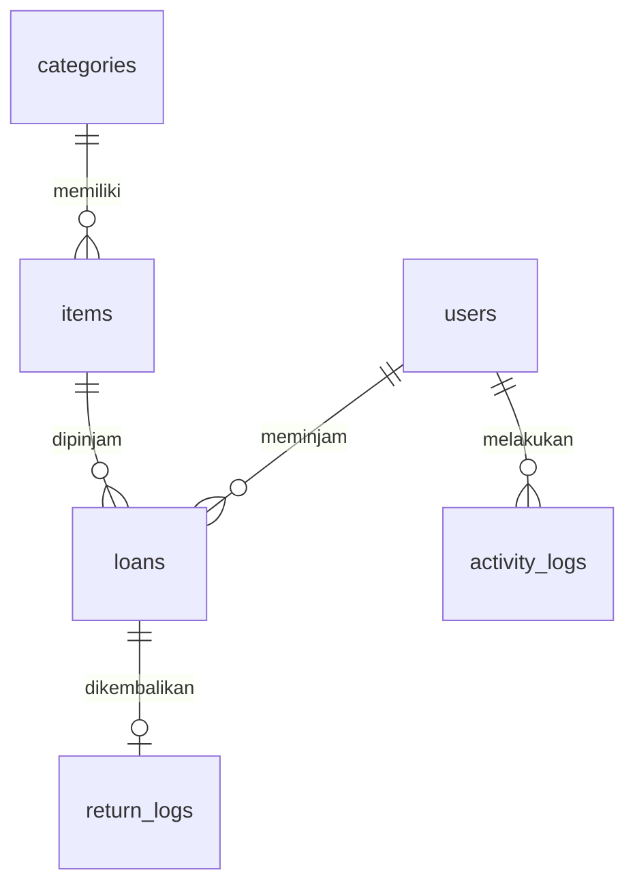

# Brief Proyek: Sistem Inventaris Sekolah

## Daftar Isi

1. [Tujuan Proyek](#1-tujuan-proyek)
2. [Ketentuan Hasil dan Contoh](#2-ketentuan-hasil-dan-contoh)
3. [Struktur Tabel Database](#3-struktur-tabel-database)
4. [ERD (Entity Relationship Diagram)](#4-erd-entity-relationship-diagram)

---

## 1. Tujuan Proyek

### Latar Belakang

Di banyak sekolah, barang inventaris seperti alat laboratorium, alat olahraga, proyektor, hingga alat kebersihan masih dicatat peminjamannya di buku catatan manual. Guru atau siswa yang ingin meminjam alat harus mencatat sendiri di buku, dan sering kali tidak ada catatan yang jelas kapan barang harus dikembalikan.

Akibatnya:

- barang sering hilang jejak,
- barang rusak tanpa diketahui siapa peminjam terakhirnya,
- stok tidak tercatat dengan akurat.

### Apa yang Harus Kamu Bangun?

Buatlah **Sistem Inventaris Sekolah** yang mencatat data barang, kategori barang, serta proses peminjaman dan pengembalian secara digital dan terpusat, sehingga mudah dipantau oleh pengelola inventaris sekolah.

Sistem digunakan oleh dua jenis pengguna:

- **Admin**: pengelola inventaris.
- **User**: guru/siswa yang meminjam barang.

> **Boleh Dikembangkan** Spesifikasi di brief ini adalah versi dasar/minimum yang **wajib** dipenuhi. Kamu diperbolehkan (sangat dianjurkan) mengembangkan proyek lebih jauh, misalnya dengan menambah halaman, fitur, atau tampilan yang relevan.

---

## 2. Ketentuan Hasil dan Contoh

### 2.1 Tech Stack (Tetap/Wajib)

Tech stack sudah ditentukan agar peserta fokus menguasai satu stack dengan matang.

| Komponen | Ketentuan |
| --- | --- |
| Framework | Laravel minimal versi 11 |
| View engine | Blade (boleh tambahan: Livewire, Alpine.js, dll.) |
| Autentikasi | **Wajib** Laravel Breeze |
| Database | MySQL (disarankan), atau database lain yang didukung Laravel, selama migration dan seeder berjalan normal |

### 2.2 Entitas / Tabel yang Wajib Ada

| Tabel | Fungsi |
| --- | --- |
| `users` | Menyimpan akun pengguna (Admin & User) beserta role-nya. |
| `categories` | Menyimpan kategori barang inventaris (misal: Alat Lab, Alat Olahraga, Elektronik). |
| `items` | Menyimpan data barang inventaris, terhubung ke kategori. |
| `loans` | Mencatat transaksi peminjaman barang oleh user. |
| `return_logs` | Mencatat detail pengembalian dari sebuah peminjaman. |
| `activity_logs` | Mencatat jejak audit (audit trail) atas aktivitas krusial Admin maupun User, seperti operasi CRUD (tambah, edit, hapus data) dan aktivitas otentikasi. |

### 2.3 Role Management

Sistem memiliki dua role utama. Penamaan role adalah asumsi dasar; boleh disesuaikan (misal "Staff" atau "Guru") selama fungsinya sama.

| Role | Hak Akses |
| --- | --- |
| **Admin** | Mengelola kategori & data barang, memverifikasi peminjaman dan pengembalian, melihat activity log, serta mengelola akun user. |
| **User** | Melihat daftar barang yang tersedia, mengajukan peminjaman, dan melihat riwayat peminjamannya sendiri. |

> **Catatan Implementasi Role** Laravel Breeze secara default tidak menyediakan sistem role. Tambahkan kolom `role` pada tabel `users` (misalnya `enum('admin','user')`), lalu gunakan Gate, Policy, atau Middleware bawaan Laravel untuk membatasi akses halaman/aksi sesuai role. Menggunakan package seperti `spatie/laravel-permission` juga boleh dan termasuk kategori "pengembangan lanjutan".

### 2.4 Seeder (Wajib)

Setiap tabel wajib memiliki seeder agar sistem bisa langsung dicoba tanpa input data manual. Ketentuan minimum:

| Data | Minimum | Catatan |
| --- | --- | --- |
| Akun Admin | 1 | Gunakan email & password yang mudah diingat, dan cantumkan kredensialnya di README repository |
| Akun User | 2 | Untuk kebutuhan testing |
| Kategori barang | 3 |  |
| Barang (`items`) | 10 | Tersebar di berbagai kategori yang sudah dibuat |
| Peminjaman (`loans`) | 5 | Dengan variasi status (contoh: sedang dipinjam & sudah dikembalikan) |
| Pengembalian (`return_logs`) | 3 | Sesuai dengan data `loans` yang berstatus sudah dikembalikan |
| `activity_logs` | Beberapa | Contoh aktivitas seperti "menambah barang", "memverifikasi peminjaman", dsb. |

### 2.5 Standard Setup Project (Konvensi Laravel)

- **Migration**: nama tabel berbentuk jamak (plural), snake_case, tanpa awalan khusus. Contoh: `items`, `return_logs`, `activity_logs`.
- **Model**: berbentuk tunggal (singular), PascalCase, mengikuti nama tabel. Contoh: `items` → `Item`; `return_logs` → `ReturnLog`.
- **Controller**: diakhiri kata `Controller` dan sesuai konten. Contoh: `ItemController`, `LoanController`.
- **View Blade**: dikelompokkan dalam folder sesuai konten. Contoh: `items/index.blade.php`, `items/create.blade.php`.
- **Soft Delete**: gunakan fitur Soft Delete bawaan Laravel (kolom `deleted_at`) untuk data yang bisa dihapus, bukan kolom `archived` manual.
- **Relasi**: gunakan Eloquent Relationship (`hasMany`, `belongsTo`, dst.) untuk seluruh relasi antar tabel. Jangan query manual dengan JOIN mentah.
- **Bahasa penamaan**: file, folder, route, model, dan controller konsisten menggunakan Bahasa Inggris.

### 2.6 Standard Quality Project

**Kualitas teknis**

- Tidak boleh ada error, baik di tampilan/view maupun console/log Laravel.
- Tidak boleh ada tombol atau aksi yang tidak berfungsi.
- Route/URL dan breadcrumbs rapi dan konsisten.

**Form**

- Setiap form input fokus otomatis ke field pertama.
- Setiap form input memiliki placeholder.
- Field wajib diberi tanda bintang (`*`), dan validasi backend menggunakan Form Request Validation Laravel.

**Tampilan data**

- Tabel menggunakan DataTable, atau pagination bawaan Laravel yang dikombinasikan dengan search/filter.
- Setiap angka diformat dengan pemisah ribuan, format Indonesia.
- Setiap tanggal menggunakan format Indonesia. Contoh: `1 Feb 2026`.

**Antarmuka dan akses**

- Tampilan bersih (clean), rapi, dan responsif di berbagai ukuran layar.
- Wajib memiliki fitur Login dan Register (bawaan Laravel Breeze).
- Menu/halaman berbeda sesuai role: Admin melihat menu pengelolaan penuh, User hanya melihat menu sesuai haknya.

---

## 3. Struktur Tabel Database

Berikut struktur kolom **minimum** untuk setiap tabel. Kamu boleh menambahkan kolom lain jika dibutuhkan, selama kolom wajib di bawah ini tetap ada.

### Tabel `users`

| Kolom | Tipe Data | Keterangan |
| --- | --- | --- |
| `id` | bigint, PK, auto increment | Primary key |
| `name` | varchar(255) | Nama pengguna |
| `email` | varchar(255), unique | Email login |
| `password` | varchar(255) | Password terenkripsi (bawaan Breeze) |
| `role` | enum('admin','user') | Menentukan hak akses pengguna |
| `email_verified_at` | timestamp, nullable | Bawaan Laravel Breeze |
| `created_at` | timestamp | Waktu data dibuat |
| `updated_at` | timestamp | Waktu data terakhir diubah |

### Tabel `categories`

| Kolom | Tipe Data | Keterangan |
| --- | --- | --- |
| `id` | bigint, PK, auto increment | Primary key |
| `name` | varchar(255) | Nama kategori barang |
| `created_at` | timestamp | Waktu data dibuat |
| `updated_at` | timestamp | Waktu data terakhir diubah |

### Tabel `items`

| Kolom | Tipe Data | Keterangan |
| --- | --- | --- |
| `id` | bigint, PK, auto increment | Primary key |
| `category_id` | bigint, FK → `categories.id` | Kategori barang ini |
| `name` | varchar(255) | Nama barang |
| `code` | varchar(50), unique | Kode/SKU unik barang |
| `stock` | integer | Jumlah stok barang tersedia |
| `condition` | enum('baik','rusak ringan','rusak berat') | Kondisi barang saat ini |
| `created_at` | timestamp | Waktu data dibuat |
| `updated_at` | timestamp | Waktu data terakhir diubah |

### Tabel `loans`

| Kolom | Tipe Data | Keterangan |
| --- | --- | --- |
| `id` | bigint, PK, auto increment | Primary key |
| `user_id` | bigint, FK → `users.id` | Pengguna yang meminjam |
| `item_id` | bigint, FK → `items.id` | Barang yang dipinjam |
| `quantity` | integer | Jumlah barang yang dipinjam |
| `loan_date` | date | Tanggal peminjaman |
| `due_date` | date | Batas waktu pengembalian |
| `status` | enum('dipinjam','dikembalikan','terlambat') | Status peminjaman saat ini |
| `created_at` | timestamp | Waktu data dibuat |
| `updated_at` | timestamp | Waktu data terakhir diubah |
| `deleted_at` | timestamp, nullable | Waktu data dihapus (Soft Delete) |

### Tabel `return_logs`

| Kolom | Tipe Data | Keterangan |
| --- | --- | --- |
| `id` | bigint, PK, auto increment | Primary key |
| `loan_id` | bigint, FK → `loans.id`, unique | Peminjaman yang dikembalikan |
| `returned_at` | date | Tanggal barang dikembalikan |
| `condition_on_return` | enum('baik','rusak ringan','rusak berat') | Kondisi barang saat dikembalikan |
| `notes` | text, nullable | Catatan tambahan dari Admin |
| `created_at` | timestamp | Waktu data dibuat |
| `updated_at` | timestamp | Waktu data terakhir diubah |
| `deleted_at` | timestamp, nullable | Waktu data dihapus (Soft Delete) |

### Tabel `activity_logs`

| Kolom | Tipe Data | Keterangan |
| --- | --- | --- |
| `id` | bigint, PK, auto increment | Primary key |
| `user_id` | bigint, FK → `users.id` | Pengguna yang melakukan aksi |
| `action` | varchar(255) | Jenis aksi, misal `create_item`, `verify_loan` |
| `description` | text | Deskripsi detail aktivitas yang dilakukan |
| `created_at` | timestamp | Waktu aktivitas terjadi |
| `updated_at` | timestamp | Waktu data terakhir diubah |

---

## 4. ERD (Entity Relationship Diagram)

ERD adalah cetak biru konseptual yang digunakan developer untuk merancang arsitektur basis data relasional secara visual, guna mengoptimalkan struktur data dan mencegah redundansi sebelum tahap implementasi.

### Penjelasan Relasi

Diagram menggambarkan hubungan antar 6 tabel dalam Sistem Inventaris Sekolah.

| Relasi | Tipe | Penjelasan | Foreign Key | Di Laravel |
| --- | --- | --- | --- | --- |
| `categories` → `items` | One to Many | Satu kategori punya banyak barang, tetapi satu barang hanya masuk ke satu kategori. | `items.category_id` → `categories.id` | `Category`: `hasMany(Item::class)` `Item`: `belongsTo(Category::class)` |
| `users` → `loans` | One to Many | Satu user bisa punya banyak transaksi peminjaman, tetapi satu transaksi hanya dilakukan satu user. | `loans.user_id` | `User`: `hasMany(Loan::class)` `Loan`: `belongsTo(User::class)` |
| `items` → `loans` | One to Many | Satu barang bisa dipinjam berkali-kali dalam transaksi berbeda (tidak bersamaan), tetapi satu transaksi hanya mengacu ke satu barang. | `loans.item_id` | `Item`: `hasMany(Loan::class)` `Loan`: `belongsTo(Item::class)` |
| `loans` → `return_logs` | One to One | Satu peminjaman punya maksimal satu catatan pengembalian (satu peminjaman = satu kali proses kembali). | `return_logs.loan_id` (unique) | `Loan`: `hasOne(ReturnLog::class)` `ReturnLog`: `belongsTo(Loan::class)` |
| `users` → `activity_logs` | One to Many | Satu user bisa punya banyak catatan aktivitas, tetapi satu catatan hanya atas nama satu user. | `activity_logs.user_id` | `User`: `hasMany(ActivityLog::class)` `ActivityLog`: `belongsTo(User::class)` |